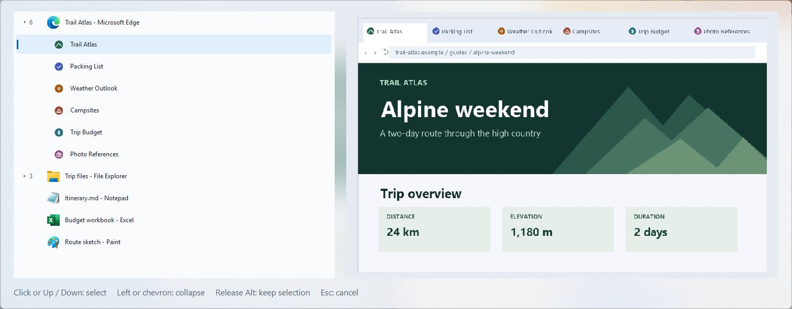
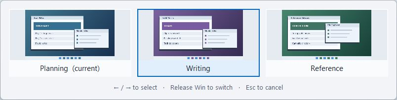

# Task & Desktop Switcher

Windows 11’s built-in **Alt+Tab** and **Win+Tab** show windows as separate thumbnails, pulling them out of the workspace where you left them. When you have dozens of apps and tabs open, it’s harder to spot the right one without the layout around it.

**Task & Desktop Switcher** keeps that context visible. The task picker brings the highlighted window forward right where you left it, with browser and File Explorer tabs listed under their parent window. The desktop picker shows snapshots of each workspace, so you can recognize a desktop by how its windows are arranged and jump straight to it.

| Switcher | Shortcut | What you get |
| --- | --- | --- |
| Window Switcher | **Alt+F12** or opt-in **Alt+Tab** | Recently used windows, expandable tab lists, and a live preview |
| Desktop Switcher | **Win+Tab** | A quick return to your last active desktop, or a visual picker when you hold **Win** |

## Get started

1. Install [AutoHotkey v2](https://github.com/AutoHotkey/AutoHotkey/releases) on Windows 11.
2. [Download the ZIP](https://github.com/GregWatto/task-desktop-switcher/archive/refs/heads/main.zip) and extract it. You can also clone the repository with `git clone https://github.com/GregWatto/task-desktop-switcher.git`.
3. Double-click `WindowSwitcher.ahk` to start both switchers. Keep `DesktopSwitcher.ahk` and the `Lib` folder alongside it.
4. Try **Alt+F12** to pick a window or **Win+Tab** to switch desktops. Create at least two virtual desktops in Windows Task View to try desktop switching.

By default, Windows still handles **Alt+Tab**. To enable the window picker on **Alt+Tab** too, run this from the extracted folder in PowerShell. Adjust the executable path for a portable or custom AutoHotkey installation.

```powershell
& "C:\Program Files\AutoHotkey\v2\AutoHotkey64.exe" ".\WindowSwitcher.ahk" --alt-tab
```

Use **Exit** from the AutoHotkey tray icon to restore the Windows shortcuts. Launch the script without `--alt-tab` to return to the default binding.

## Window Switcher



Windows appear in most-recently-used order, with tabs nested under their parent window. Windows stay where you left them on screen and on their assigned desktops. Highlighting a window temporarily brings it forward for a live preview. As you move through the picker, previously previewed windows return to their place in the stack, so the workspace stays easy to navigate.

Moving off a previewed tab restores the tab that was active before previewing it. Releasing **Alt** keeps the highlighted window or tab active. Pressing **Esc** restores the starting window and stack.

| Input | Action |
| --- | --- |
| **Alt+F12** | Open on the first row. Keep holding **Alt** and press **F12** again to cycle windows. |
| **Alt+Tab** in opt-in mode | Open on the previous window. Keep holding **Alt** and press **Tab** again to cycle. A quick tap switches directly. |
| **Shift** with either shortcut | Cycle windows in reverse. |
| **↑** / **↓** | Move through windows and expanded tabs, wrapping at the ends. |
| **→** or click the chevron | Expand a window's tabs. Press **→** again to highlight the first tab. |
| **←** on an expanded window or tab | Collapse the tabs and highlight their window. Clicking the chevron also collapses the list. |
| Click a row | Highlight the window or tab. |
| Release **Alt** | Commit the highlighted window or tab. |
| **Esc** | Cancel and restore the starting window and window order. |

Microsoft Edge, Google Chrome, and File Explorer have dedicated tab detection. Edge and Chrome tabs show their site icons when the picker can read them from the visible horizontal tab strip. Other apps can expose tabs through Windows UI Automation. Coverage depends on the app and tab layout. For example, tabs inside a collapsed Edge group may be hidden from the picker. A window remains selectable when its tabs are unavailable. The chevron appears when the picker detects at least two tabs.

The picker reads the Windows app theme and transparency setting at launch. Restart it to apply changes.

## Desktop Switcher



Tap **Win+Tab** to return to the last active virtual desktop when Windows exposes that information. To choose another desktop, press **Win+Tab** and keep holding **Win** until the preview cards appear.

| Input while holding **Win** | Action |
| --- | --- |
| **Tab** / **Shift+Tab** | Cycle forward or backward, wrapping at the ends. |
| **←** / **→** or **↑** / **↓** | Move one desktop at a time, stopping at the ends. |
| Click a preview | Highlight that desktop. |
| Release **Win** | Switch to the highlighted desktop. |
| **Esc** | Cancel. |

Cards use the desktop names and order from Windows Task View and mark the current desktop. The picker updates its snapshot of the current desktop's primary monitor about every 1.5 seconds while both pickers are closed. Each desktop shows the last snapshot from your visit. Snapshots stay in memory and clear when the script exits.

Direct animated switching uses an internal Explorer interface from the Windows 11 24H2 generation. If direct switching is unavailable, the picker uses the built-in desktop shortcuts. Use the taskbar's **Task View** button to open the Windows overview.

## Contributing and license

See [Contributing](CONTRIBUTING.md) for the source layout and manual checks. The switchers are released under the [MIT License](LICENSE). See [Third-party notices](THIRD_PARTY_NOTICES.md) for the bundled UI Automation library and the virtual desktop interface reference.
